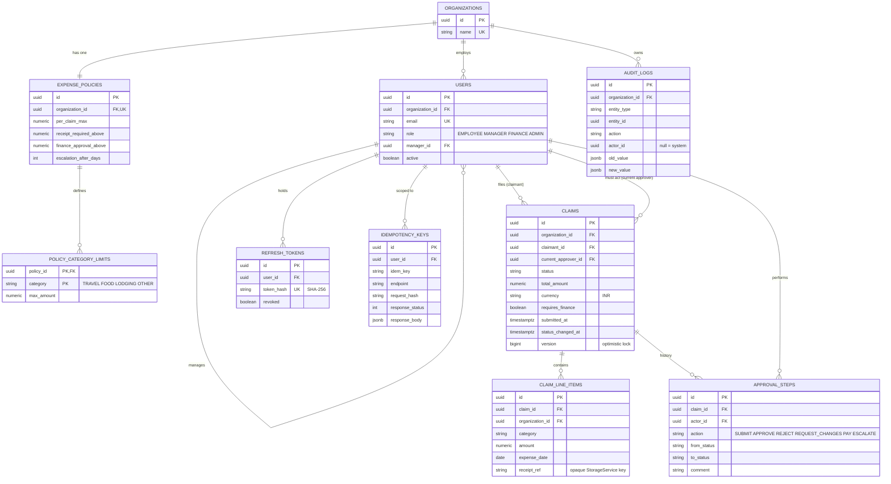
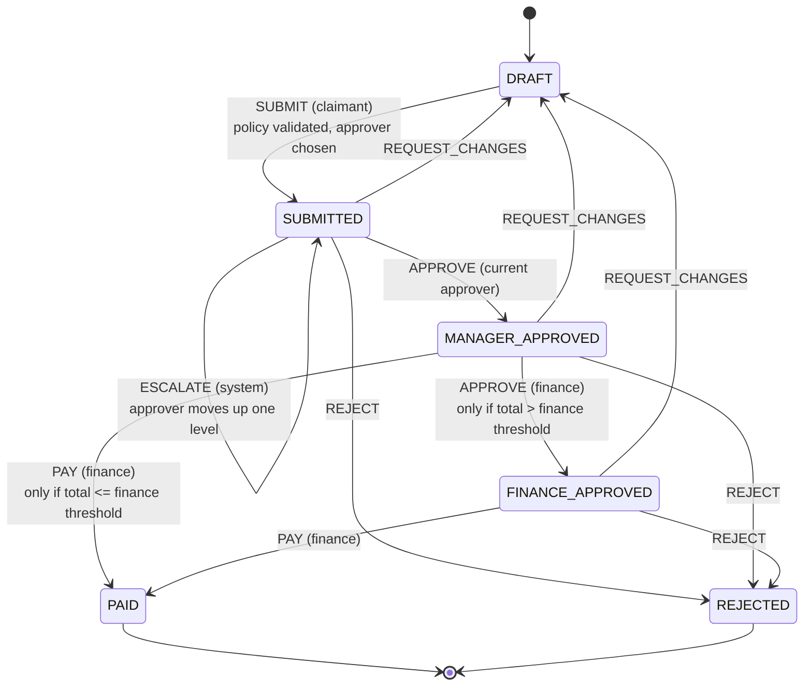

# ClaimFlow

Expense reimbursement and approval workflow for companies, as a production-style Spring Boot backend.

Employees file claims with line items and receipts. A manager approves, large claims also need finance, and
finance marks them paid. Every organisation is a separate tenant. The interesting parts are correctness under
concurrency (optimistic locking, idempotency keys), a strict state machine, and keeping the database
authoritative (Flyway owns the schema, Hibernate only validates it).

**Stack:** Java 21 · Spring Boot 3.5 · PostgreSQL 16 · Flyway · Spring Security + JWT · Redis · springdoc (Swagger) ·
JUnit 5 / Mockito / Testcontainers · Docker Compose · GitHub Actions · k6

---

## Contents
1. [Quick start](#quick-start)
2. [Architecture](#architecture)
3. [Data model](#data-model)
4. [Workflow state machine](#workflow-state-machine)
5. [API overview](#api-overview)
6. [Design decisions](#design-decisions)
7. [Testing](#testing)
8. [Load test results](#load-test-results)
9. [Known limitations](#known-limitations)

---

## Quick start

### With Docker (recommended)
```bash
docker compose up --build
```
This starts the app, PostgreSQL and Redis. The app loads a demo organisation on first start (the `demo` profile).

| | |
|---|---|
| API | http://localhost:8080 |
| Swagger UI | http://localhost:8080/swagger-ui.html |
| Health | http://localhost:8080/actuator/health |

Demo users (password for all: `Demo@1234`):

| Email | Role | Reports to |
|---|---|---|
| admin@acme.demo | ADMIN | |
| priya.director@acme.demo | MANAGER | |
| rahul.manager@acme.demo | MANAGER | Priya |
| anita.employee@acme.demo, vikram.employee@acme.demo | EMPLOYEE | Rahul |
| meera.finance@acme.demo, karan.finance@acme.demo | FINANCE | |

The seed contains claims in every state (draft, waiting for manager, waiting for finance, finance-approved, paid,
rejected, changes-requested) and four months of paid history for the reports.

Try it:
```bash
TOKEN=$(curl -s localhost:8080/api/v1/auth/login -H 'Content-Type: application/json' \
  -d '{"email":"rahul.manager@acme.demo","password":"Demo@1234"}' | python3 -c 'import sys,json;print(json.load(sys.stdin)["accessToken"])')
curl -s localhost:8080/api/v1/claims/pending-approvals -H "Authorization: Bearer $TOKEN"
```
Remove `SPRING_PROFILES_ACTIVE: demo` from `docker-compose.yml` for an empty database, and set `JWT_SECRET`
(at least 32 bytes) for anything other than a local demo.

### Without Docker for the app
Needs JDK 21, Maven and a running PostgreSQL and Redis (for example `docker compose up postgres redis`, after
adding `ports:` for them).
```bash
mvn spring-boot:run -Dspring-boot.run.profiles=demo
```
Configuration is by environment variable: `DB_URL`, `DB_USER`, `DB_PASSWORD`, `DB_POOL_SIZE`, `REDIS_HOST`,
`REDIS_PORT`, `JWT_SECRET`, `STORAGE_ROOT`.

### Tests
```bash
mvn test      # unit tests, no Docker needed
mvn verify    # unit tests + integration tests (needs Docker: Testcontainers starts Postgres and Redis)
```

### Load test
```bash
k6 run k6/load-test.js
# or without installing k6, against the compose stack:
docker run --rm -i --network claimflow_default -v "$PWD/k6:/k6" -e BASE_URL=http://app:8080 \
  -e PRE_CLAIMS=3000 grafana/k6 run /k6/load-test.js
```

---

## Architecture

```mermaid
flowchart LR
    client([Client / Swagger / k6]) -->|HTTPS + Bearer JWT| sec

    subgraph app [Spring Boot application]
        sec[JwtAuthFilter<br/>stateless security] --> ctrl[Controllers<br/>validation, DTOs]
        ctrl --> idem[IdempotencyService]
        idem --> wf[ClaimWorkflowService<br/>maker-checker, stage authority]
        ctrl --> svc[ClaimService / PolicyService<br/>UserService / ReportService]
        wf --> sm[ClaimStateMachine<br/>pure, no I/O]
        wf --> pv[PolicyValidator]
        wf --> audit[AuditService]
        wf -. publishes after commit .-> evt((ClaimStatusChangedEvent))
        evt --> notif[Async notification listener<br/>bounded thread pool]
        notif --> mail[EmailSender<br/>logging stub]
        sched[EscalationJob<br/>@Scheduled] --> wf
        svc --> store[StorageService<br/>interface]
        store --> disk[(Local disk<br/>S3 later)]
    end

    wf --> repo[Spring Data JPA<br/>entity graphs, @Version]
    svc --> repo
    audit --> repo
    repo --> pg[(PostgreSQL<br/>Flyway-managed schema)]
    svc -->|policy cache, evict after commit| redis[(Redis)]
```

Package layout (by feature): `auth`, `user`, `organization`, `policy`, `claim` (`domain`, `approval`, `report`),
`idempotency`, `storage`, `notification`, `scheduler`, `security`, `config`, `common` (`audit`, `exception`,
`tenant`, `web`), `demo`.

---

## Data model


The full DDL is in [`V1__schema.sql`](src/main/resources/db/migration/V1__schema.sql). `created_by` /
`updated_by` / `created_at` / `updated_at` columns are filled by JPA auditing.

---

## Workflow state machine



Rules enforced by `ClaimWorkflowService`, in this order:
1. **Visibility.** Callers who cannot see the claim get 404 (existence is not leaked). Drafts are visible only to their author.
2. **Maker-checker.** The claimant can never approve, reject, request changes on or pay their own claim (403). A manager's own claim goes to their manager.
3. **State machine.** Illegal transitions are 409.
4. **Stage authority.** The manager stage belongs to `current_approver_id` (a user with the MANAGER role); the finance stages belong to the FINANCE role.

Reject and request-changes require a comment.

---

## API overview

All endpoints are under `/api/v1`, take and return JSON, and need `Authorization: Bearer <accessToken>` except
`/auth/*`. Errors always look like:
```json
{ "timestamp": "...", "status": 409, "error": "Conflict", "code": "CONCURRENT_MODIFICATION",
  "message": "...", "path": "/api/v1/claims/.../approve", "details": ["..."] }
```
Interactive docs: `/swagger-ui.html`.

| Area | Endpoint | Who |
|---|---|---|
| **Auth** | `POST /auth/register` create an organisation and its first ADMIN | public |
| | `POST /auth/login`, `POST /auth/refresh` | public |
| **Users** | `GET /users/me` | any |
| | `POST /users`, `GET /users`, `GET /users/{id}`, `PUT /users/{id}` (name, role, manager, active) | ADMIN |
| **Policy** | `GET /policy` (cached in Redis) | any |
| | `POST /policy`, `PUT /policy`, `DELETE /policy` | ADMIN |
| **Drafts** | `POST /claims`, `GET /claims/{id}`, `PUT /claims/{id}`, `DELETE /claims/{id}` | claimant |
| | `POST /claims/{id}/items`, `PUT` / `DELETE /claims/{id}/items/{itemId}` | claimant |
| | `POST /claims/{id}/items/{itemId}/receipt` (multipart `file`; PDF, PNG, JPEG), `GET` the same path to download | claimant / anyone who can see the claim |
| **Workflow** | `POST /claims/{id}/submit` | claimant |
| | `POST /claims/{id}/approve`, `/reject`, `/request-changes` | manager, then finance |
| | `POST /claims/{id}/pay` | FINANCE |
| **Queries** | `GET /claims/mine?status=&page=&size=&sort=` | any |
| | `GET /claims/pending-approvals` | MANAGER, FINANCE |
| **Reports** | `GET /reports/spend?from=&to=&groupBy=MONTH\|CATEGORY\|MONTH_CATEGORY&status=&sort=&dir=&page=&size=` | ADMIN, FINANCE |
| **Ops** | `GET /actuator/health`, `/actuator/info`, `/actuator/metrics` | health and info public |

Workflow endpoints accept an optional `Idempotency-Key` header. A replayed response carries
`Idempotent-Replay: true`. List endpoints return `{content, page, size, totalElements, totalPages}`, cap the
page size at 100, and reject sort fields outside a whitelist with 400.

---

## Design decisions

### Optimistic locking for concurrent approvals
`Claim` has a `@Version` column. Each approver loads the claim, checks the rules, and writes it back with
`UPDATE ... WHERE id = ? AND version = ?`. If two approvers act at the same time, the second update matches zero
rows, Hibernate raises an optimistic-lock failure, the whole transaction rolls back, and the exception handler
returns **409 `CONCURRENT_MODIFICATION`**. The claim row is flushed *before* the approval step, audit row and
event are written, so the loser leaves nothing behind.

*Why not pessimistic locks (`SELECT ... FOR UPDATE`)?* Conflicts are rare (a claim has a handful of actors, one
at a time), so locking every approval to protect against a rare race would serialise work and hold a connection
while a user "thinks". Optimistic locking costs nothing on the happy path, never blocks, and failing fast with 409
is a correct answer for a human who should re-read the claim anyway. The same mechanism makes the escalation job
safe to run on several instances without a distributed lock.

### Idempotency keys
`submit`, `approve`, `reject`, `request-changes` and `pay` accept an `Idempotency-Key`. The key row is inserted
with `INSERT ... ON CONFLICT DO NOTHING` **in the same database transaction as the business change**, and the
response is stored on that same row.
- A concurrent duplicate blocks on the unique index until the first transaction finishes, then replays its stored
  response. There is no "in progress" limbo and no timeout to tune.
- If the work fails or rolls back, the key row disappears with it, so a retry runs for real.
- Keys are scoped to user + endpoint + claim. Reusing a key for a different request returns 422.
- Old keys are purged after 24 hours.

*Why:* networks retry. A mobile client that times out on "pay" must be able to retry without paying twice. Doing
it in the same transaction removes the classic bug where the work commits but the key does not (or the reverse).
Without a key, a repeated submit is still safe: the state machine answers 409.

### An explicit state machine
`ClaimStateMachine` is a pure function `(status, action, requiresFinance) -> status` with no Spring, database or
clock. The service asks it before touching an entity.
*Why:* the legal transitions are the business rules, so they live in one small, exhaustively unit-tested place
(21 test cases) instead of being scattered across `if` statements in controllers. Authorisation is deliberately
separate (who may act at a stage is not the same question as whether the move is legal). `requires_finance` is
fixed at submit time so a later policy change cannot move a claim already in flight.

### Caching (Redis)
Only the organisation policy is cached. It is read on every submit and changes rarely. The cached value is an
immutable `PolicySnapshot` record serialised as JSON (readable in `redis-cli`, no JPA proxies in the cache).
- **Evict after commit,** not inside the transaction. Evicting earlier lets a concurrent reader re-fill the cache
  with the old row before the update commits and keep serving it until the TTL.
- A cache error handler makes Redis **fail open**: if Redis is down the app reads PostgreSQL.
- Not cached: claims. They change constantly and are read mostly by their owners; correctness matters more than
  saving one indexed query.

### Multi-tenancy
Shared database, shared schema, `organization_id` on every tenant-owned table.
- The organisation id comes from the verified JWT (`TenantContext`), never from a request parameter, so a caller
  cannot name another tenant.
- Every repository lookup that takes a client-supplied id also takes the organisation id
  (`findByIdAndOrganizationId`, `findDetailed(id, orgId)`).
- Resources of another tenant return **404, not 403**, so ids cannot be probed.
- Line items and audit rows carry `organization_id` too, so reports and audit queries filter on an indexed column
  without joining.

*Why not schema-per-tenant or database-per-tenant?* They isolate harder but cost migrations, connection pools and
operations per tenant. For an application of this shape a discriminator column with tests that prove isolation
is the pragmatic choice. The isolation tests cover users, policies, drafts, claims, reports and workflow actions.
The trade-off is that isolation depends on every query remembering the filter; PostgreSQL row-level security would
add defence in depth and is the obvious next step.

### Other decisions worth knowing
- **Flyway owns the schema; Hibernate runs `ddl-auto=validate`.** A mismatch between an entity and the schema
  fails startup (this caught a real `CHAR(3)` vs `String` mismatch during development).
- **UUID primary keys** so ids cannot be enumerated across tenants.
- **JWT access tokens (15 min) plus opaque, hashed, rotating refresh tokens (7 days).** Access tokens carry user,
  organisation and role, so authorisation needs no database call. Refresh tokens are stored as SHA-256 hashes and
  rotated on every use; presenting an already-used token revokes the user's whole chain (theft detection).
- **Notifications are sent after commit and asynchronously** (`@TransactionalEventListener(AFTER_COMMIT)` +
  bounded executor), so nobody is told about a change that rolled back and a slow mail server cannot slow an
  approval. They are best-effort (at most once); a transactional outbox or RabbitMQ would give at-least-once.
- **N+1 avoidance:** single-claim loads use an entity graph; list pages join the people but deliberately not the
  item collection (fetching a collection with `LIMIT` makes Hibernate paginate in memory); an integration test
  asserts a 6-row page issues no more than 3 SQL statements.
- **Reports are SQL `GROUP BY`,** not Java loops, with `ORDER BY` taken from a fixed whitelist.
- **Audit trail in two layers:** JPA auditing stamps `created_by`/`updated_by` on rows, and `audit_logs` records
  each state change with old and new values and the actor (null actor = the scheduler).
- **Receipts behind `StorageService`.** The database stores an opaque reference, so an S3 implementation can be
  dropped in. The local implementation generates its own file names, checks content type and size, and refuses
  path traversal.

---

## Testing

`mvn verify` runs **83 tests** (40 unit, 43 integration); all pass locally and in GitHub Actions.

| Layer | What it proves |
|---|---|
| `ClaimStateMachineTest` | every legal and illegal transition, both finance paths, terminal states |
| `PolicyValidatorTest` | category limits, per-claim max, receipt threshold boundaries, all violations reported together |
| `JwtServiceTest`, `LocalStorageServiceTest`, `AsyncConfigTest` | token expiry/tampering, upload safety and traversal, the notification-executor deadlock regression |
| `WorkflowIT` | full large-claim path, small-claim shortcut, **maker-checker**, stage authority, policy rejection, request-changes and resubmit, terminal rejection |
| `ConcurrentApprovalIT` | **two threads approve the same claim: exactly one 200, one 409**, one recorded step; also approve vs reject. Repeated 15 and 10 times; in the local run, the `@Version` check itself stopped the loser in all 15 finance rounds. A deterministic test shows a stale second writer is refused. |
| `IdempotencyIT` | replay returns the original response, **10 parallel submits with one key do the work once**, key reuse with a different request is 422, failed requests do not consume the key |
| `PolicyCacheIT` | policy lands in Redis, update evicts it, next read refills it |
| `SchedulerIT` | overdue claim moves up one level with an audit row by the system, old approver loses rights, per-organisation threshold, no double escalation |
| `QueryIT` | paging, sorting, whitelist, queues, the N+1 statement-count guard, spend report |
| `Auth/UserManagement/DraftClaim/DemoSeed/SchemaMapping IT` | tokens and reuse detection, RBAC, tenant isolation, receipts, seed data, schema/entity agreement |

Integration tests use Testcontainers (real PostgreSQL 16 and Redis 7) and call the running app over HTTP.

---

## Load test results

Script: [`k6/load-test.js`](k6/load-test.js). It creates its own organisation, then runs two scenarios one after
the other with 20 virtual users each:
- **submit:** for 30 s, each iteration creates a draft and submits it with an `Idempotency-Key`; every 5th
  iteration retries with the same key and must get the stored response.
- **approve:** 3,000 claims that were already submitted are approved by their manager; every 5th claim is
  approved a second time and must get 409.

**Measured environment (not a production sizing):** an Apple M2 Mac (8 cores, 8 GB RAM),
Docker Desktop with 8 CPUs / about 3.8 GiB. The app, PostgreSQL, Redis and k6 all ran on that one machine, so
they competed for the same CPUs. App connection pool: 20.

Final run ([raw output](docs/load-test/run-after-fix.txt)), all thresholds passed:

| | requests | avg | median | p90 | p95 | max |
|---|---|---|---|---|---|---|
| all requests | 47,856 | 14.14 ms | 10.71 ms | 28.08 ms | 37.53 ms | 557.44 ms |
| `submit` | | 19.36 ms | 15.63 ms | 34.77 ms | **45.24 ms** | 183.65 ms |
| `approve` | | 21.09 ms | 14.88 ms | 38.58 ms | **52.95 ms** | 235.36 ms |

- Failed requests: **0 of 47,856**; checks passed: **48,294 of 48,294**.
- Average throughput across the run: 765.7 requests/s (62.5 s, including both scenarios).
- 3,481 idempotent replays were each answered with the stored result and the `Idempotent-Replay` header.
- 600 duplicate approvals were each rejected with 409.
- The approve scenario finished its 3,000 claims in 3.7 s (about 810 claims/s, derived from those two numbers).
- Thresholds set in the script: p95 < 500 ms for submit and approve, under 1% failed requests, over 99% checks.

**What the load test found.** The first 3,000-claim run ([raw output](docs/load-test/run-before-fix.txt)) was not
clean: 10 of 49,219 requests failed (0.02%), 8 approvals returned an error, and the slowest request took 30.18 s
even though p95 looked fine (52.48 ms). The logs showed `HikariPool-1 - Connection is not available, request timed
out after 30000ms (total=10, active=10)`. Cause: the notification executor used `CallerRunsPolicy`; when its
queue filled, the after-commit listener ran on the request thread, which still held its transaction's connection
and needed a second one. With more such threads than pool connections, the pool deadlocked until the timeout.
Fix: drop notifications when the queue is full instead of running them on the caller, a larger queue, a
configurable pool size and a 10 s connection timeout (commits `fix: drop notifications...` and `config: make
Hikari pool size...`), with a unit test that pins the behaviour. The numbers above are from the run after the fix.
An earlier, smaller run (300 claims) had passed all thresholds before this was found, which is why the larger
run is the one to trust.

---

## Known limitations

- **Access tokens stay valid until they expire (15 minutes)** after a user is deactivated; refresh tokens stop at
  once. A token deny-list in Redis would close the gap.
- **Notifications are at-most-once** and only logged; there is no real mail provider and no outbox.
- **One escalation level per run;** the top of the hierarchy has nobody to escalate to and the claim stays put.
  Only the manager stage escalates (finance is a pool, not a person).
- **Receipts are stored on local disk** (a Docker volume in compose). The `StorageService` interface is the seam
  for S3.
- **Single currency (INR),** and an ADMIN cannot approve claims (admin and approver are separate duties).
- **No rate limiting or account lockout** on the login endpoint.
- **Tenant isolation is enforced in application code and tests,** not by PostgreSQL row-level security.
- Load-test numbers come from one laptop with everything co-located; treat them as a sanity check and regression
  baseline, not capacity planning.
